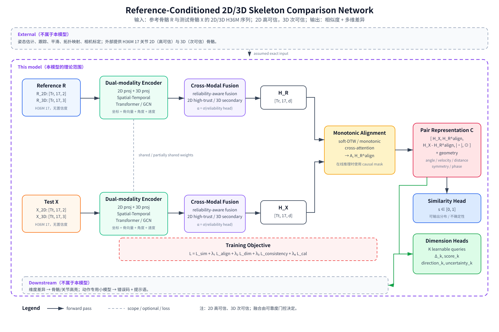

# 参考骨骼条件下的实时多维动作评估方案（论文理论版）

> 文档日期：2026-09-17  
> 适用目标：以“标准动作骨骼序列 + 测试动作骨骼序列”为输入，输出粗判相似度和多维差异，并能进一步驱动前端骨骼高亮与动作专用反馈。

---

## 0. 一句话结论

该方案可行，且工程上可以先用规则与几何特征跑通；但从论文角度看，**应用层面已经存在高度接近的工作，纯系统实现不足以构成强创新**。真正需要收敛的创新点是：

1. 参考骨骼条件下的结构化多维评估；
2. 粗相似度与多维差异来自同一套时间对齐表示；
3. 在线因果对齐，而不是离线 DTW；
4. 多维差异带方向、严重度和置信度，可作为下游骨骼高亮的输入；
5. 动作专用小模型把结构化差异映射为错误码与提示语（下游可选）；
6. 2D/3D 统一表示、概率校准和跨视角鲁棒性。

### 0.1 研究版黑盒定义（最新收敛）

本项目为论文服务，应用层不是重点。模型不负责视频处理、人体检测、姿态估计、跟踪或平滑，这些全部由外部模型负责。本模型只研究：

> 输入待测动作与标准动作的 2D/3D 骨骼序列，输出“像不像”的粗判以及各维度差异（角度、速度等）。

形式化定义：

- 标准动作 2D 骨骼：
$$
  R^{2D} \in \mathbb{R}^{T_r \times 17 \times 2}
$$

- 标准动作 3D 骨骼：
$$
  R^{3D} \in \mathbb{R}^{T_r \times 17 \times 3}
$$

- 待测动作 2D 骨骼：
$$
  X^{2D} \in \mathbb{R}^{T_t \times 17 \times 2}
$$

- 待测动作 3D 骨骼：
$$
  X^{3D} \in \mathbb{R}^{T_t \times 17 \times 3}
$$

输入假设：

- 2D 和 3D 同时输入；
- 采用 H36M 17 关节定义；
- 输入不含置信度；
- 论文理论分析采用 2D 高可信、3D 次可信的精度不对称假设；如果假定 3D 绝对精确，则 2D 是其确定性投影，模型应退化为 3D-only（见 0.2）；
- 姿态估计误差、遮挡和低质量骨骼不作为核心变量，最多作为鲁棒性实验。

模型核心输出只有两层：

1. `similarity`：待测动作与标准动作的整体相似度；
2. `difference`：各维度差异向量，如角度、速度、距离、对称性等。

骨骼高亮、错误码和自然语言反馈属于下游应用映射，不进入核心模型定义。

### 0.2 2D/3D 精度假设与理论定位

如果同时假设 2D 和 3D 都绝对精准，并且相机参数已知，则 2D 只是 3D 的确定性投影：
$$
X^{2D} = \pi(X^{3D})
$$

此时 2D 不提供任何 3D 之外的新信息，2D/3D 融合在信息论意义上是冗余的，方案应退化为 3D-only。  
因此，2D 要有独立价值，必须至少引入以下一种设定：

| 设定                  | 2D 的独立价值                        |
| --------------------- | ------------------------------------ |
| 2D 比 3D 更可信       | 2D 作为可靠观测，3D 作为带噪估计     |
| 相机参数未知          | 2D 可用于约束投影几何                |
| 3D 由 2D lifting 得到 | 2D 可校验 3D 的投影一致性            |
| 任务定义在图像平面    | 某些指标本身是视角相关的             |
| 缺失模态              | 只有 2D 或只有 3D 时模型需要退化运行 |

对本论文而言，推荐采用**精度不对称假设**：
$$
X^{2D} = \pi(Z) + \epsilon_{2D},
\qquad
X^{3D} = Z + \epsilon_{3D}
$$

其中 $Z$ 是潜在的真实 3D 运动，$\epsilon_{2D}$ 是 2D 观测噪声，$\epsilon_{3D}$ 是 3D 观测噪声，并且：
$$
\sigma_{2D}^2 \ll \sigma_{3D}^2
$$

也就是：

- 2D 高可信，接近“精准”；
- 3D 次可信，存在 lifting 误差、深度歧义和尺度误差；
- 模型需要做可靠度感知融合：主要由 2D 提供投影约束，由 3D 提供空间几何信息；
- 当 3D 不可靠时，模型应自动退化为 2D 主导。

如果 3D 由 2D 估计得到，还必须显式建模两者的误差相关性，否则朴素融合会产生过度自信。

---

## 1. 问题定义

### 1.1 输入

模型同时接收标准动作和待测动作的 2D/3D 骨骼：

标准动作：
$$
  R^{2D} \in \mathbb{R}^{T_r \times 17 \times 2},
  \quad
  R^{3D} \in \mathbb{R}^{T_r \times 17 \times 3}
$$

待评估动作：
$$
  X^{2D} \in \mathbb{R}^{T_t \times 17 \times 2},
  \quad
  X^{3D} \in \mathbb{R}^{T_t \times 17 \times 3}
$$

其中：

- $T_r, T_t$：参考序列和测试序列的帧数；
- 关节数固定为 17；
- 2D 和 3D 同时输入，不是二选一；
- 输入不含关节置信度；
- 理论设定一：3D 精确且相机已知，则 2D 是其确定性投影，模型退化为 3D-only；
- 理论设定二（推荐）：2D 高可信、3D 次可信，研究可靠度感知的 2D/3D 融合与结构化差异建模。

### 1.2 输出

核心输出只有两个层面：

1. **粗判相似度**：测试动作与参考动作的整体匹配程度，取值 $[0,1]$。
2. **多维差异**：按维度输出参考值、测试值、差值、方向、误差等，例如角度、速度、距离、对称性。

以下内容属于下游应用层，不是本文核心模型定义：

3. **骨骼级定位**：供前端在叠加骨骼层上高亮错误点。
4. **动作专用反馈**：由下游小模型输出错误码和提示语，例如“下蹲程度不足”“请保持身体直立”。

### 1.3 关键区分

必须区分两个概念：

- **匹配相似度（match similarity）**：这段动作是否像目标动作；
- **动作质量（form quality）**：如果它是目标动作，做得是否标准。

一个幅度很浅、膝内扣的深蹲，仍然“很像深蹲”，但质量差。  
因此建议内部至少保留两个分数：
$$
s_{\text{match}}, \quad s_{\text{form}}
$$

对外可以只暴露综合分：
$$
s_{\text{overall}} = f(s_{\text{match}}, s_{\text{form}})
$$

---

## 2. 可行性判断（按职责边界拆分）

### 2.1 本模型负责的问题

本项目只研究：给定已提取的 2D/3D H36M 骨骼序列，如何建模参考动作与测试动作之间的相似度和多维差异。

| 子问题                 | 难度 | 可行性 | 说明                                       |
| ---------------------- | ---: | -----: | ------------------------------------------ |
| 2D/3D 骨骼表示学习     |   中 |     高 | 如何把两种模态映射到可比较的共享空间       |
| 2D/3D 跨模态融合       | 中高 |   中高 | 模态鸿沟、尺度、坐标和视角问题是核心理论点 |
| 参考—测试时间对齐      |   中 |     高 | soft-DTW、单调 cross-attention、相位对齐   |
| 粗相似度建模           |   中 |     高 | 排序、对比、回归、校准概率均可             |
| 多维差异建模           |   中 |     高 | 角度、速度、距离、对称性等可结构化定义     |
| 相似度与维度差异一致化 | 中高 |     中 | 需要一致性约束，是论文可写的理论点         |
| 在线因果对齐           | 中高 |   中高 | 离线双向模型不能直接在线部署               |
| 概率校准与不确定性     |   中 |   中高 | 让 $[0,1]$ 具有可解释的概率意义            |
| 论文级创新性           | 中高 |     中 | 必须聚焦 2D/3D 融合、结构化差异和理论分析  |

### 2.2 外部因素，不计入本模型任务

| 因素                 | 归属             | 说明                               |
| -------------------- | ---------------- | ---------------------------------- |
| 2D 姿态估计稳定性    | 外部姿态模型     | 本模型不负责从图像提取骨骼         |
| 2D 遮挡、抖动、跳变  | 外部姿态模型     | 论文理论分析中可假定输入精确       |
| 3D lifting 误差      | 外部 3D 姿态模型 | 深度歧义和尺度误差不属于本模型核心 |
| 人体检测与跟踪       | 外部前端         | 本模型不做跟踪                     |
| 相机视角标定         | 外部数据协议     | 可以在数据采集和预处理中处理       |
| 骨骼拓扑统一         | 外部接口层       | 输入必须已映射为 H36M 17 关节      |
| 骨骼平滑与缺失值处理 | 外部预处理       | 非本文核心建模内容                 |
| 骨骼级错误高亮       | 下游应用         | 由维度差异映射到关节/骨骼后渲染    |
| 动作专用反馈小模型   | 下游应用         | 输入是结构化差异，不是核心模型本身 |

### 2.3 容易被误判为外部因素、但本模型仍可研究的问题

| 问题             | 为什么仍属于本模型                                     |
| ---------------- | ------------------------------------------------------ |
| 2D 视角不变性    | 即使骨骼已给定，2D 表示仍受视角影响，属于表示学习问题  |
| 2D/3D 模态鸿沟   | 两种坐标空间不可直接比较，属于融合理论问题             |
| 尺度与朝向规范化 | 需要定义不破坏动作语义的规范形式                       |
| 时间速度差异     | 参考和测试速度不同，需要在模型内区分时间差异和动作差异 |
| 缺失模态         | 只有 2D 或只有 3D 时模型是否退化运行，属于泛化问题     |
| 相似度与质量解耦 | “像不像”和“做得好不好”需要形式化区分                   |

核心工程原则：

1. 先做时间对齐，再做空间差异。
2. 不直接比较原始坐标，比较骨骼向量、关节角、角速度和归一化距离。
3. 粗相似度和多维差异必须来自同一个对齐后的表示。
4. 实时版本必须是因果的；离线双向模型只能作为 teacher。

---

## 3. 相关工作与重合度

### 3.1 最接近的工作

| 工作                                                                                                                  | 出处                                                                     | 重合点                                                                                | 缺口                                                                             |
| --------------------------------------------------------------------------------------------------------------------- | ------------------------------------------------------------------------ | ------------------------------------------------------------------------------------- | -------------------------------------------------------------------------------- |
| **AI-Driven Vision-Based Fitness Coaching Using Adaptive Skeleton Matching and Real Time Feedback System**            | I5CPS 2026，DOI: 10.1109/i5cps67958.2026.11452603                        | 骨骼规范化对齐、参考位置、关节角容差、时序一致性、偏差高亮、重复计数、音频反馈        | 偏启发式阈值；没有多模态多维评分、校准相似度、统一结构化输出协议和动作专用小模型 |
| **Monocular 2D/3D human Pose Analysis for Online Personal Training**                                                  | ICCE 2026，DOI: 10.1109/icce67443.2026.11449790                          | 2D/3D 统一管线、reference 与 user 对比、bone-vector angle、实时骨骼叠加、局部关节偏差 | 偏 qualitative；没有学习式多维评分和结构化反馈                                   |
| **FLAG3D++: A Benchmark for 3D Fitness Activity Comprehension With Language Instruction**                             | TPAMI 2025，DOI: 10.1109/tpami.2025.3590012                              | 180K 序列、60 类健身动作、语言指令、Language-guided AQA、HL-GCN                       | 是语言引导的 AQA 基准，不是参考骨骼直接匹配                                      |
| **Pose-estimation and improved-DTW model for track-and-field movement quality evaluation**                            | Entertainment Computing 2026，DOI: 10.1016/j.entcom.2026.101212          | 姿态估计 + 改进 DTW + 质量评估                                                        | 非健身场景，没有 2D/3D 统一和多维骨骼级输出                                      |
| **Skeleton-Based AQA with Anomaly-Aware DTW Optimization**                                                            | Sensors 2025，DOI: 10.3390/s25237160                                     | 骨骼 AQA + DTW + 异常检测                                                             | 不是参考模板匹配，也没有前端骨骼高亮协议                                         |
| **Spatiotemporal skeleton based learning for automatic exercise quality assessment and real time posture correction** | Scientific Reports 2026，DOI: 10.1038/s41598-026-52118-1                 | 健身动作质量评估 + 实时姿态纠正                                                       | 没有明确提出“参考骨骼 + 测试骨骼 + 多维差异 + 动作专用反馈”的统一框架            |
| **Exercise quality assessment in monocular video streaming**                                                          | Engineering Applications of AI 2026，DOI: 10.1016/j.engappai.2026.114905 | 单目视频流中的实时动作质量评估                                                        | 不是骨骼对骨骼的参考条件化                                                       |
| **AIFit: Automatic 3D Human-Interpretable Feedback Models for Fitness Training**                                      | CVPR 2021，DOI: 10.1109/cvpr46437.2021.00979                             | 可解释的健身反馈                                                                      | 偏单人质量反馈，不是任意参考骨骼条件化                                           |
| **FLEX: A Large-scale Multimodal, Multiview Dataset for Fitness AQA**                                                 | arXiv:2506.03198，2025                                                   | 多视角、3D 姿态、sEMG、专家知识图                                                     | 主要是数据集和基准，不是完整在线系统                                             |
| **Fitness-AQA / FitAQA**                                                                                              | 2024–2026                                                                | 大规模健身动作质量数据集和评价                                                        | 主要提供数据和评测，不覆盖完整结构化输出                                         |
| **KIMORE**                                                                                                            | IEEE TNSRE 2019，DOI: 10.1109/tnsre.2019.2923060                         | 康复动作与临床评分                                                                    | 不是任意参考骨骼条件化                                                           |
| **NTU RGB+D 60/120**                                                                                                  | CVPR 2016 / TPAMI 2019                                                   | 骨骼动作识别预训练                                                                    | 只提供动作识别标签，不提供质量评分                                               |

### 3.2 文献结论

**应用层面**已经有几乎一样的工作，尤其是 I5CPS 2026 和 ICCE 2026 两篇。  
**研究层面**还没有一篇同时覆盖：

- 任意参考骨骼条件化；
- 在线因果时间对齐；
- 校准后的粗相似度；
- 多维差异与骨骼级定位；
- 动作专用反馈小模型；
- 2D/3D 统一和跨视角鲁棒性。

因此论文不能定位为“首个实时骨骼动作纠正系统”，应定位为：

> 参考骨骼条件下的结构化在线动作评估，结合多维骨骼级错误定位、概率校准和动作专用反馈生成。

---

## 4. 总体方案

```text
标准骨骼 R_2D / R_3D ──┐
                        ├─ 规范化 → 双模态编码 → 双时间对齐 → 差异表示 Δ ─┬─ 粗判相似度
测试骨骼 X_2D / X_3D ──┘                                                   └─ 多维差异

下游可选：骨骼/关节定位 → 前端高亮；动作专用小模型 → 错误码 + 提示语
```

整体分四层：

1. **规范层**：统一骨骼拓扑、坐标、尺度、朝向和时间轴。
2. **对齐层**：相位估计与在线时间对齐，区分时间差异和动作差异。
3. **差异层**：计算每个维度的参考值、测试值、差值、方向、严重程度和置信度。
4. **决策层**：核心生成粗相似度和多维差异；骨骼高亮与动作专用反馈为下游可选映射。

---

## 5. 网络结构

> 架构图文件：[网络架构.svg](网络架构.svg)



推荐结构：

```text
参考骨骼 R_2D/R_3D ──┐
                      ├─ 双模态编码器 ─→ 时间对齐 ─→ 成对交互 ─┬─ 粗相似度头
测试骨骼 X_2D/X_3D ──┘                                          └─ 多维差异头

下游可选：骨骼定位头、动作专用反馈头
```

### 5.1 输入分支

输入同时包含 2D 和 3D 骨骼。参考动作与待测动作分别进入共享或部分共享的编码器。

输入张量：
$$
R^{2D}\in\mathbb{R}^{B\times T_r\times17\times2},
\quad
R^{3D}\in\mathbb{R}^{B\times T_r\times17\times3}
$$
$$
X^{2D}\in\mathbb{R}^{B\times T_t\times17\times2},
\quad
X^{3D}\in\mathbb{R}^{B\times T_t\times17\times3}
$$

推荐三条分支并行：

| 分支     | 输入                            | 作用                         |
| -------- | ------------------------------- | ---------------------------- |
| 2D 分支  | $\mathbb{R}^{T\times17\times2}$ | 图像平面内的姿态和运动模式   |
| 3D 分支  | $\mathbb{R}^{T\times17\times3}$ | 真实空间中的角度、距离和朝向 |
| 运动分支 | 2D/3D 的一阶、二阶差分          | 速度、加速度、节奏           |

2D/3D 融合有三种基本方式：

1. **早融合**：直接拼接 2D 和 3D 坐标；
2. **中间融合**：各自编码后做 cross-attention；
3. **晚融合**：两个分支独立输出，再在相似度和差异头上融合。

推荐中间融合。它允许模型分别学习 2D 视角模式和 3D 度量信息，再在特征层对齐。

在 0.2 的精度不对称假设下，推荐使用**可靠度感知融合**，而不是把 2D 和 3D 当成同等可信：
$$
\alpha
=
\sigma\left(f_{\text{rel}}\left(H^{2D},H^{3D}\right)\right)
$$
$$
H
=
\alpha\odot H^{2D}
+
(1-\alpha)\odot H^{3D}
$$

当 3D 次可信时，模型应主要通过 2D 约束投影一致性，并把 3D 作为带不确定性的空间先验：
$$
H
=
H^{2D}
+
\lambda\cdot
\operatorname{CrossAttn}\left(H^{2D},H^{3D}\right)
$$

其中 $\lambda$ 是可学习或由可靠度估计得到的权重。

融合后的表示记为：
$$
H_R\in\mathbb{R}^{B\times T_r\times17\times d},
\quad
H_X\in\mathbb{R}^{B\times T_t\times17\times d}
$$

### 5.2 骨骼编码器

可选方案：

1. **工程基线**：ST-GCN 或 CTR-GCN，计算量小。
2. **推荐主模型**：轻量 Transformer 或 MotionBERT 风格编码器。
3. **2D/3D 统一模型**：2D 和 3D 各有投影层，共享主干，加 modality embedding，用对比损失对齐 2D 和 3D 特征。

输出：
$$
H_R\in\mathbb{R}^{B\times T_r\times17\times d},
\quad
H_X\in\mathbb{R}^{B\times T_t\times17\times d}
$$

其中 $d$ 建议取 128 或 256。

### 5.3 时间对齐模块

离线训练：

- soft-DTW；
- OTAM；
- monotonic cross-attention；
- 输出对齐矩阵：
$$
  A \in \mathbb{R}^{T_t \times T_r}
$$

实时推理：

- causal cross-attention；
- monotonic mask；
- 在线 DTW 或相位跟踪；
- 每个测试帧只能访问当前和历史参考信息。

对齐后得到：
$$
H_R^{\text{align}} = A H_R
$$

同时输出：

- `phase`：当前动作相位；
- `progress`：动作进度；
- `alignment_confidence`：对齐置信度。

### 5.4 成对交互模块

对齐后的参考特征和测试特征做交互：
$$
P=\operatorname{MLP}\left(
\left[
H_X,\,
H_R^{\text{align}},\,
H_X-H_R^{\text{align}},\,
\left|H_X-H_R^{\text{align}}\right|,\,
H_X\odot H_R^{\text{align}}
\right]
\right)
$$

或使用 cross-attention：

- 测试 token 作为 query；
- 参考 token 作为 key/value；
- 加单调对齐 mask；
- 输出 $P\in\mathbb{R}^{B\times T_t\times J\times d_p}$。

### 5.5 输出头

核心输出头只有前两个：粗相似度头和多维差异头。骨骼定位头和动作专用反馈头属于下游应用扩展。

#### 头 1：粗相似度头
$$
g=\operatorname{TemporalPool}(P)+\operatorname{JointPool}(P)
$$
$$
s_{\text{logit}}=\operatorname{MLP}(g),
\qquad
s=\sigma\left(s_{\text{logit}}\right)
$$

输出：

- `match_similarity`；
- `match_confidence`；
- 可选 `uncertainty`。

如果参考有多个模板，使用 max 或 attention 聚合。

#### 头 2：多维差异头

定义 K 个可学习维度 query：
$$
q_1,q_2,\dots,q_K\in\mathbb{R}^{d}
$$

每个 query 与 `P` 做 cross-attention，同时拼接几何特征：
$$
z_k=\left[\operatorname{CrossAttn}(q_k,P),\,
\operatorname{GeoFeatures}_k\right]
$$

每个维度输出：

- 参考值；
- 测试值；
- 差值；
- 方向；
- 归一化误差；
- 分数；
- 严重程度；
- 置信度。

#### 头 3：骨骼定位头

把维度误差映射到骨骼和关节：
$$
\text{bone\_error}=f_{\text{bone}}(P)
$$

也可以用固定映射：

- 膝角误差 → 大腿、小腿、膝；
- 躯干倾角 → 脊柱、肩、髋；
- 站距误差 → 两腿、双脚；
- 对称性误差 → 左腿、右腿。

输出：

```text
bone: [from_joint, to_joint]
joint: joint_id
error_type
severity
confidence
```

前端只按这个结构高亮，不参与计算。

#### 头 4：动作专用反馈头

每个动作一个小的 MLP、GBDT 或 GRU：

```text
input: [dimension_scores, deltas, severities, confidence, phase]
output: multi-label error codes + severity
```

然后由模板或受约束的语言模型生成提示语。

### 5.6 损失函数
$$
\mathcal{L}
=
\mathcal{L}_{\text{sim}}
+\lambda_1\mathcal{L}_{\text{align}}
+\lambda_2\mathcal{L}_{\text{dim}}
+\lambda_3\mathcal{L}_{\text{loc}}
+\lambda_4\mathcal{L}_{\text{feedback}}
+\lambda_5\mathcal{L}_{\text{cal}}
$$

| 损失                            | 作用                         |
| ------------------------------- | ---------------------------- |
| $\mathcal{L}_{\text{sim}}$      | 正负样本对比、排序、BCE      |
| $\mathcal{L}_{\text{align}}$    | 单调性、DTW 路径、对齐一致性 |
| $\mathcal{L}_{\text{dim}}$      | Huber 回归、方向分类、排序   |
| $\mathcal{L}_{\text{loc}}$      | 骨骼级误差监督               |
| $\mathcal{L}_{\text{feedback}}$ | 错误码多标签分类             |
| $\mathcal{L}_{\text{cal}}$      | 概率校准、NLL、ECE           |

一致性损失：
$$
\mathcal{L}_{\text{consistency}}
=
\left|
s-\operatorname{Aggregate}\left(\text{dimension\_scores}\right)
\right|
$$

避免粗相似度和多维差异互相矛盾。

### 5.7 实时策略

1. 先训练离线双向 teacher；
2. 再用 causal mask 训练在线 student；
3. 使用特征蒸馏和输出蒸馏对齐；
4. 每帧只维护滑动窗口和增量对齐路径；
5. 用 EMA 或卡尔曼滤波平滑输出。

### 5.8 2D/3D 融合的理论问题

这是本文最值得展开的理论部分，而不是应用层细节。核心问题包括：

1. **模态鸿沟**：2D 坐标是投影结果，3D 坐标是世界或相机坐标，两个空间不可直接比较。
2. **视角不变性**：2D 骨骼受视角影响，3D 骨骼更适合度量角度，但单目 3D 可能有深度歧义。本文假设骨骼精确后，可以把视角问题建模成坐标变换下的不变性。
3. **尺度与朝向**：2D 和 3D 的尺度、原点、朝向不同，需要定义可辨识的规范形式。
4. **同步性**：2D 和 3D 必须时间对齐，且要与参考动作的时间轴对齐，形成双重对齐问题。
5. **信息互补性**：2D 提供图像平面运动，3D 提供真实角度和距离，模型需要学习何时依赖哪个模态。
6. **缺失模态**：如果只给 2D 或只给 3D，模型是否仍能退化运行，可以作为理论扩展。
7. **相似度与质量解耦**：整体相似度和各维度差异之间需要形式化的一致性约束。

建议在论文中把上述问题表述为：

> 在精确 H36M 2D/3D 骨骼假设下，参考动作与待测动作的双模态结构化相似度建模。

---

## 6. 输入输出详细定义

### 6.1 骨骼格式与坐标规范

必须固定：

- 关节定义：H36M 17 关节；
- 2D：形状 `[N, 17, 2]`，x 向右，y 向上；
- 3D：形状 `[N, 17, 3]`，x 向右，y 向上，z 向前；
- 输入不含置信度；
- 所有坐标转换为根节点相对坐标；
- 所有骨骼按统一长度归一化；
- 2D 和 3D 同时输入，`N` 为帧数，2D/3D 的 `N` 应一致。

### 6.2 H36M 17 关节定义

H36M 17 关节采用以下约定：

```text
0  Hip
1  Right Hip
2  Right Knee
3  Right Foot
4  Left Hip
5  Left Knee
6  Left Foot
7  Spine
8  Thorax
9  Neck / Nose
10 Head
11 Left Shoulder
12 Left Elbow
13 Left Wrist
14 Right Shoulder
15 Right Elbow
16 Right Wrist
```

如果外部模型使用其他拓扑，必须在上游统一映射到该 H36M 17 关节顺序。

### 6.3 输入数据结构

```text
reference.skeleton_2d: [T_r, 17, 2]
reference.skeleton_3d: [T_r, 17, 3]
test.skeleton_2d:      [T_t, 17, 2]
test.skeleton_3d:      [T_t, 17, 3]
```

```json
{
  "reference": {
    "action_id": "squat",
    "skeleton_2d": [],
    "skeleton_3d": []
  },
  "test": {
    "session_id": "subject_001",
    "skeleton_2d": [],
    "skeleton_3d": []
  },
  "meta": {
    "joint_format": "h36m_17",
    "fps": 30,
    "camera_view": "front"
  }
}
```

### 6.4 统一输出

核心输出是 `coarse` 和 `dimensions`。`localization` 与 `feedback` 是下游应用映射，可以保留为可选字段。

注意：输入骨骼不含置信度；输出中的 `confidence` 表示模型对维度估计和相似度判断的置信度或不确定性，不是输入骨骼的置信度。

输出分 `frame`、`rep`、`session` 三个 scope，结构相同。

```json
{
  "version": "1.0",
  "scope": "rep",
  "time": 2.4,
  "action_id": "squat",
  "reference_id": "squat_ref_001",

  "coarse": {
    "match_similarity": 0.81,
    "match_confidence": 0.93,
    "form_score": 0.67,
    "overall_score": 0.74,
    "calibrated": true
  },

  "temporal": {
    "phase": "bottom",
    "progress": 0.42,
    "alignment_confidence": 0.94
  },

  "dimensions": [
    {
      "id": "knee_flexion_depth",
      "name": "下蹲深度",
      "category": "spatial",
      "phase": "bottom",
      "ref_value": 92.0,
      "test_value": 121.0,
      "delta": 29.0,
      "unit": "deg",
      "direction": "insufficient",
      "error": 0.58,
      "score": 0.42,
      "severity": 0.81,
      "confidence": 0.91,
      "valid": true,
      "joints": ["left_knee", "right_knee"],
      "bones": [
        ["left_hip", "left_knee"],
        ["left_knee", "left_ankle"],
        ["right_hip", "right_knee"],
        ["right_knee", "right_ankle"]
      ]
    }
  ],

  "localization": [
    {
      "joint": "left_knee",
      "bone": ["left_hip", "left_knee"],
      "error_type": "insufficient_flexion",
      "severity": 0.81,
      "confidence": 0.91
    }
  ],

  "feedback": [
    {
      "code": "INSUFFICIENT_DEPTH",
      "message": "下蹲程度不足，请继续下蹲到大腿接近水平",
      "severity": "high",
      "related_dimensions": ["knee_flexion_depth"],
      "related_bones": [
        ["left_hip", "left_knee"],
        ["left_knee", "left_ankle"]
      ]
    }
  ]
}
```

### 6.5 各字段语义

| 字段               | 含义                                 |
| ------------------ | ------------------------------------ |
| `match_similarity` | 粗判：测试动作与参考动作的整体相似度 |
| `match_confidence` | 粗判置信度                           |
| `form_score`       | 由多维差异聚合出的质量分             |
| `overall_score`    | 对外展示的综合分                     |
| `phase`            | 当前相位                             |
| `progress`         | 动作进度                             |
| `dimensions`       | 多维结构化差异                       |
| `localization`     | 前端高亮使用的骨骼/关节级错误        |
| `feedback`         | 动作专用提示                         |

### 6.6 维度对象字段

| 字段         | 含义                                  |
| ------------ | ------------------------------------- |
| `id`         | 稳定维度 ID                           |
| `category`   | spatial / temporal / dynamic          |
| `ref_value`  | 参考值                                |
| `test_value` | 测试值                                |
| `delta`      | 测试值减参考值，保留正负              |
| `direction`  | insufficient / excessive / asymmetric |
| `error`      | 归一化误差                            |
| `score`      | 该维度得分 $[0,1]$                    |
| `severity`   | 严重程度 $[0,1]$                      |
| `confidence` | 该维度置信度                          |
| `valid`      | 当前视角/相位下是否可靠               |
| `joints`     | 相关关节                              |
| `bones`      | 相关骨骼                              |

### 6.7 下游小模型输入输出

输入：

```text
z = [
  dimension_scores,
  deltas,
  severities,
  confidences,
  phase_one_hot,
  action_embedding,
  last_N_frames_history
]
```

输出：

```text
error_codes: multi-label
severity_per_code: [0,1]
message_template_id
```

示例：

```json
{
  "error_codes": ["INSUFFICIENT_DEPTH", "TRUNK_TOO_FORWARD"],
  "severity": {
    "INSUFFICIENT_DEPTH": 0.81,
    "TRUNK_TOO_FORWARD": 0.64
  },
  "message_ids": ["MSG_DEPTH", "MSG_TRUNK"]
}
```

---

## 7. 动作维度定义示例：深蹲

| 维度 ID               | 名称     | 计算方式                      | 高亮对象       | 适用视角    |
| --------------------- | -------- | ----------------------------- | -------------- | ----------- |
| `knee_flexion_depth`  | 下蹲深度 | 最低点膝屈角，或髋部下降比    | 髋、膝、踝     | 侧面最佳    |
| `knee_tracking`       | 膝轨迹   | 正面投影中膝相对髋-踝线的偏移 | 膝、大腿、小腿 | 正面/斜正面 |
| `trunk_lean`          | 躯干前倾 | 躯干向量与竖直方向夹角        | 脊柱、肩、髋   | 侧面        |
| `stance_width`        | 站距     | 两踝距离 / 肩宽               | 两腿、双脚     | 正面        |
| `left_right_symmetry` | 左右对称 | 左右膝角或髋角差              | 左腿、右腿     | 正面        |
| `tempo`               | 节奏     | 下降/上升时长和底部停顿       | 全身时序       | 任意        |
| `stability`           | 稳定性   | 躯干摆动或重心代理方差        | 躯干、髋       | 任意        |

---

## 8. 数据与标注

### 8.1 数据来源

预训练：

- NTU RGB+D 60/120；
- Human3.6M；
- MPI-INF-3DHP；
- MotionBERT 预训练特征。

目标动作微调与评测：

- Fitness-AQA；
- FLEX；
- FitAQA；
- KIMORE；
- UI-PRMD；
- 自采深蹲数据。

### 8.2 标注内容

标注不应只有“好/坏”，而应结构化：

- 每个维度的错误方向：不足、过大、不对称；
- 严重程度：轻微、中等、严重；
- 错误码：`INSUFFICIENT_DEPTH`、`TRUNK_TOO_FORWARD`、`KNEE_VALGUS` 等；
- 可选：骨骼级错误区域。

如果专家标注昂贵，可以：

1. 先用规则生成弱标签；
2. 再用少量专家修正；
3. 训练模型预测弱标签的残差和置信度。

### 8.3 数据划分

必须包含：

- 跨受试者划分；
- 跨视角划分；
- 速度变化划分；
- 遮挡和低置信度划分；
- 如果可能，跨数据集迁移测试。

---

## 9. 训练策略

### 阶段 1：无学习基线

- DTW 或相位对齐；
- 关节角与距离规则；
- 输出多维差异和骨骼高亮。

目标是验证接口和前端显示。

### 阶段 2：学习粗相似度

- 用正负样本对比或排序损失；
- 正样本：同一动作、合理变形；
- 负样本：错误动作、时间反转、半程、速度异常、关节扰动。

### 阶段 3：学习多维差异

- 每个维度一个 head；
- 输出差值、方向、严重程度、置信度；
- 几何特征和网络特征融合。

### 阶段 4：学习骨骼级定位

- 用维度到骨骼的固定映射；
- 或用 per-bone head 学习误差区域；
- 保证前端高亮稳定。

### 阶段 5：动作专用反馈模型

- 每个动作一个 MLP/GBDT/GRU；
- 输入多维差异向量；
- 输出错误码和严重程度；
- 最后通过模板生成提示语。

---

## 10. 评估指标

### 粗相似度

- AUROC / AUPRC；
- F1@threshold；
- Spearman / Pearson 与专家判断；
- ECE / Brier 分数。

### 多维差异

- 每个维度的 MAE；
- 每个维度的方向准确率；
- 严重程度校准误差；
- 与专家评分的排序相关性。

### 骨骼定位

- 错误区域命中率；
- 高亮区域与专家标注的 IoU；
- 前端可用性人工评分。

### 动作反馈

- 错误码 macro-F1；
- 提示语相关性人工评分；
- 高危错误的漏报率。

### 实时性

- 端到端延迟；
- FPS；
- 抖动程度；
- 丢帧和低置信度情况下的稳定性。

---

## 11. 工程落地路线（次要，服务论文验证）

### 第 1 周：协议定义

- 选定一个动作，例如深蹲；
- 定义 canonical skeleton；
- 定义维度和错误码；
- 定义输入输出 JSON schema；
- 定义视角适用性。

### 第 2–3 周：离线基线

- 姿态提取；
- 骨骼规范化；
- DTW/相位对齐；
- 几何维度计算；
- 离线验证高亮和分数。

### 第 4–5 周：实时化

- 滑动窗口；
- 在线对齐；
- 输出平滑；
- WebSocket 推送；
- 前端骨骼叠加。

### 第 6–8 周：数据与学习模型

- 采集参考和测试数据；
- 规则弱标签；
- 训练粗相似度头；
- 训练多维差异头；
- 训练动作专用反馈模型。

### 第 9–12 周：论文级实验

- 在线因果对齐；
- 2D/3D 统一；
- 跨视角和跨受试者；
- 概率校准；
- 与 DTW、AIFit、骨骼 AQA、VLM 基线对比。

---

## 12. 推荐技术栈（次要）

| 模块     | 推荐工具                                     |
| -------- | -------------------------------------------- |
| 2D 姿态  | MMPose、RTMPose、MediaPipe                   |
| 3D 姿态  | MotionBERT、VideoPose3D、GVHMR               |
| 骨骼模型 | PyTorch、PyTorch Geometric、MMAction2        |
| 时间对齐 | fastdtw、dtaidistance、tslearn、自写在线 DTW |
| 实时服务 | FastAPI + WebSocket                          |
| 部署     | ONNX Runtime、TensorRT                       |
| 评估     | scikit-learn、SciPy、自定义 AQA 指标         |
| 数据存储 | `.npz` / JSON 骨骼，避免保存原始视频         |

---

## 13. 论文创新点建议

建议主线：

> 参考骨骼条件下的结构化在线动作评估：多维差异、骨骼级错误定位、概率校准和动作专用反馈。

可拆成以下贡献：

1. 统一的参考骨骼—测试骨骼结构化表示；
2. 在线因果时间对齐，分离时间差异和动作差异；
3. 多维可解释评分，并与骨骼高亮一一对应；
4. 校准后的粗相似度和不确定性输出；
5. 动作专用反馈小模型与错误码 taxonomy；
6. 2D/3D 统一和跨视角鲁棒性评测。

---

## 14. 风险与注意事项

1. **应用侧已有近似工作**：I5CPS 2026 的系统非常接近，必须明确差异化。
2. **2D 视角限制**：膝内扣等维度只在特定视角有效，必须输出 `valid`。
3. **3D 单目噪声**：绝对角度不可全信，必须置信度加权和平滑。
4. **参考动作变异性**：单个参考模板太脆，建议 3–10 个模板。
5. **时间对齐错误**：对齐失败会污染所有维度，需输出 `alignment_confidence`。
6. **粗相似度与维度不一致**：必须用一致性损失约束。
7. **标注成本**：专家多维标注是最贵的一环，先用规则弱标签。
8. **实时因果性**：不能用双向模型直接部署，需 teacher-student 蒸馏。
9. **前端拓扑不一致**：必须统一 joint ID 和 bone edge ID。

---

## 15. 工程 MVP 验收标准（次要）

- 一个动作，例如深蹲；
- 1–5 个参考模板；
- 2D 和 3D 骨骼同时输入；
- 输出 6–8 个维度；
- 每个维度带骨骼高亮映射；
- 实时 15–30 FPS；
- 端到端延迟 < 100ms；
- 粗相似度与专家评分 Spearman > 0.6；
- 维度方向判断准确率 > 80%；
- 错误码 F1 达到可用水平；
- 跨视角性能下降可量化、可解释。

---

## 16. 待确认决策

论文正式开工前需要确认：

1. 2D/3D 融合采用早融合、中间融合还是晚融合？
2. `similarity` 定义为校准概率、距离度量还是排序分数？
3. 多维差异包含哪些维度，K 取多少？
4. 参考动作是单模板还是多模板，如何聚合？
5. 时间对齐是在线因果的还是离线全局的？
6. 是否要对不确定性、视角不变性或模态缺失做理论分析？
7. 目标数据集使用 NTU RGB+D、Fitness-AQA、FLEX、FitAQA 还是自采数据？
8. 论文的主贡献是结构化差异建模、2D/3D 融合、在线对齐，还是概率校准？


