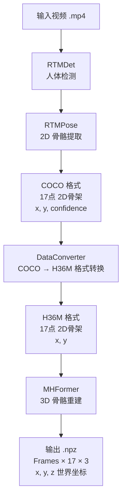
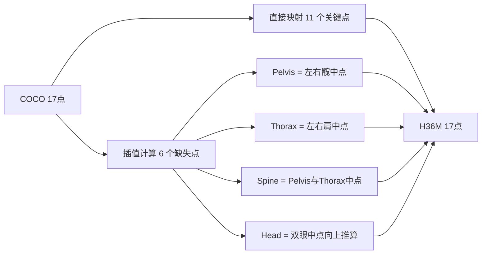

# 模型资料

识别流程分为两个阶段：**前端 2D 识别 + 后端 3D 重建**。

## 1. 整体工作流



## 2. 预设工作流

项目地址: [https://github.com/hiromuraki/kp3d_extractor](https://github.com/hiromuraki/kp3d_extractor)

运行说明: [https://github.com/hiromuraki/kp3d_extractor/blob/main/README.md](https://github.com/hiromuraki/kp3d_extractor/blob/main/README.md)

| 组件        | 选型                  | 来源                                                                                   |
| ----------- | --------------------- | -------------------------------------------------------------------------------------- |
| 人体检测    | RTMDet-m              | [https://github.com/open-mmlab/mmdetection](https://github.com/open-mmlab/mmdetection) |
| 2D 姿态估计 | RTMPose-l             | [https://github.com/open-mmlab/mmpose](https://github.com/open-mmlab/mmpose)           |
| 3D 姿态重建 | MHFormer (351-frames) | [https://github.com/Vegetebird/MHFormer](https://github.com/Vegetebird/MHFormer)       |

> MHFormer 预训练权重下载 (`model_4294.pth` (约 120 MB)): [https://drive.google.com/drive/folders/1UWuaJ_nE19x2aM-Th221UpdhRPSCFwZa?usp=sharing](https://drive.google.com/drive/folders/1UWuaJ_nE19x2aM-Th221UpdhRPSCFwZa?usp=sharing)

---

## 3. 阶段一：前端 2D 识别

前端由两个模型串联完成，通过 `MMPoseInferencer` 统一调用 (`pose2d="rtmpose-l"`, `det_model="rtmdet-m"`)，底层自动完成检测 → 关键点提取的端到端流水线。


### 3.1. RTMPose 概览

RTMPose 采用 **Top-Down**（自上而下）多人姿态估计范式：先检测人物边界框，再对每个人物实例进行单人关键点识别。其内部包含两个独立模型：

| 模型      | 用途                             | 来源                                                                                   |
| --------- | -------------------------------- | -------------------------------------------------------------------------------------- |
| RTMDet-m  | 检测图像中的人物位置（bbox）     | [https://github.com/open-mmlab/mmdetection](https://github.com/open-mmlab/mmdetection) |
| RTMPose-l | 基于 bbox 提取人体 17 点 2D 骨架 | [https://github.com/open-mmlab/mmpose](https://github.com/open-mmlab/mmpose)           |

两者通过 `MMPoseInferencer` 统一调用，底层自动串联检测 → 关键点提取的端到端流水线。

#### 3.1.1. RTMDet-m

RTMDet (Real-Time Models for Object Detection) 是一个为实时推理优化的目标检测器家族，使用 CSPNeXt 作为骨干网络。

| 属性     | 值                                                                                                                  |
| -------- | ------------------------------------------------------------------------------------------------------------------- |
| 论文     | [RTMDet: An Empirical Study of Designing Real-Time Object Detectors](https://arxiv.org/abs/2212.07784) (arXiv 2022) |
| GitHub   | [https://github.com/open-mmlab/mmdetection](https://github.com/open-mmlab/mmdetection)                              |
| 骨干网络 | CSPNeXt                                                                                                             |
| 关键设计 | 大核深度可分离卷积 (5×5)、动态软标签分配、Cached Mosaic + MixUp 数据增强                                            |

#### 3.1.2. RTMPose-l

RTMPose (Real-Time Multi-person Pose Estimation) 同样基于 CSPNeXt 骨干。RTMPose-l 是其中 large 规格的变体。

| 属性     | 值                                                                                                  |
| -------- | --------------------------------------------------------------------------------------------------- |
| 论文     | [RTMPose: Real-Time Multi-Person Pose Estimation based on MMPose](https://arxiv.org/abs/2303.07399) |
| GitHub   | [https://github.com/open-mmlab/mmpose](https://github.com/open-mmlab/mmpose)                        |
| 骨干网络 | CSPNeXt-l                                                                                           |
| 关键设计 | Top-Down 范式、SimCC 轻量分类头、基于 CSPNeXt 的编解码器架构                                        |
| 输出     | COCO 17 关键点，每点 `(x, y, confidence)`                                                           |

### 3.2. 输出

- 形状: `[Persons, Frames, 17, 3]` — 每点含 `(x, y, confidence)`
- Persons 维度取视频中单帧最大人数，不足人数的帧用全 0 填充

### 3.3. COCO 17 点格式

COCO 17 点为 RTMPose 输出的骨骼格式

| 索引 | 部位           |
| ---- | -------------- |
| 0    | Nose           |
| 1    | Left Eye       |
| 2    | Right Eye      |
| 3    | Left Ear       |
| 4    | Right Ear      |
| 5    | Left Shoulder  |
| 6    | Right Shoulder |
| 7    | Left Elbow     |
| 8    | Right Elbow    |
| 9    | Left Wrist     |
| 1    | Right Wrist    |
| 1    | Left Hip       |
| 1    | Right Hip      |
| 1    | Left Knee      |
| 1    | Right Knee,    |
| 1    | Left Ankle     |
| 1    | Right Ankle    |

---

## 4. 阶段二：COCO → H36M 格式转换

`DataConverter` 将 COCO 17 点映射为 H36M 17 点。COCO 缺少骨盆(Pelvis)、脊椎(Spine)、胸骨(Thorax)，通过已知点插值补齐。



### 4.1. H36M 17 点映射表

| H36M 索引 | 名称               | 来源                               |
| --------- | ------------------ | ---------------------------------- |
| 0         | Pelvis             | (左髋+右髋)/2 插值                 |
| 1         | Right Hip          | COCO 12                            |
| 2         | Right Knee         | COCO 14                            |
| 3         | Right Foot (Ankle) | COCO 16                            |
| 4         | Left Hip           | COCO 11                            |
| 5         | Left Knee          | COCO 13                            |
| 6         | Left Foot (Ankle)  | COCO 15                            |
| 7         | Spine              | (Pelvis+Thorax)/2 插值             |
| 8         | Thorax             | (左肩+右肩)/2 插值                 |
| 9         | Neck/Nose          | COCO 0                             |
| 10        | Head Top           | 双眼中点 + (双眼中点 − Nose) × 1.5 |
| 11        | Left Shoulder      | COCO 5                             |
| 12        | Left Elbow         | COCO 7                             |
| 13        | Left Wrist         | COCO 9                             |
| 14        | Right Shoulder     | COCO 6                             |
| 15        | Right Elbow        | COCO 8                             |
| 16        | Right Wrist        | COCO 10                            |

---

## 5. 阶段三：后端 3D 重建 (MHFormer)

### 5.1. 模型信息

| 属性       | 值                                                                                            |
| ---------- | --------------------------------------------------------------------------------------------- |
| 模型       | MHFormer (CVPR 2022)                                                                          |
| 论文       | [Multi-Hypothesis Transformer for 3D Human Pose Estimation](https://arxiv.org/abs/2111.12707) |
| GitHub     | [https://github.com/Vegetebird/MHFormer](https://github.com/Vegetebird/MHFormer)              |
| 预训练权重 | `model_4294.pth` (~120 MB)                                                                    |
| 时序窗口   | 351 帧                                                                                        |
| 滑动步长   | 60 帧                                                                                         |
| 输入       | `[Frames, 17, 2]` (H36M 格式 x, y 坐标)                                                       |
| 输出       | `[Frames, 17, 3]` (x, y, z 世界坐标)                                                          |

### 5.2. 推理策略

| 策略          | 说明                                                  |
| ------------- | ----------------------------------------------------- |
| 归一化        | 2D 坐标归一化到 `[-1, 1]`                             |
| 滑动窗口      | stride=60 滑动 351 帧窗口，重叠区加权平均实现时序平滑 |
| Root-Relative | 所有坐标以骨盆(第 0 点)为中心归零                     |

---

## 6. 最终输出

`.npz` 压缩文件:

```text
keypoints: ndarray, shape=(Frames, 17, 3), dtype=float32
```

| 维度 | 含义                                              |
| ---- | ------------------------------------------------- |
| 0    | 帧索引                                            |
| 1    | 17 个 H36M 关键点 (索引定义同阶段二映射表)        |
| 2    | `(x, y, z)` 3D 坐标，以骨盆为原点，毫米级世界坐标 |

---

## 7. 依赖环境

| 依赖        | 版本        |
| ----------- | ----------- |
| Python      | 3.8.19      |
| PyTorch     | 2.0.0+cu118 |
| MMDetection | 3.2.0       |
| MMPose      | 1.3.2       |
| MMCV        | 2.1.0       |

具体详见 `pyproject.toml`
